# Customer Segmentation & Churn Pattern Analytics in European Banking

*A data-driven study of 10,000 customers | Source: European_Bank.csv | Prepared 13 November 2026*

## Abstract

This study analyses 10,000 retail banking customer records to understand who leaves the bank and which customer groups carry the greatest attrition risk. Overall, 2,037 customers churned, an attrition rate of **20.37%**. Churn is strongly uneven. Customers in Germany churn at 32.4% against 16.2% in France and 16.7% in Spain; customers aged 50-59 churn at 56.0%; customers holding three or four products churn at 85.9%; and inactive members churn at 26.9% compared with 14.3% for active members. Credit score, tenure, credit card ownership and estimated salary show little or no practical association with churn. Six explainable, rule-based segments are defined; the two highest-risk segments (Product Overload and Inactive 50+) contain 7.6% of customers but 30.8% of all churners. A baseline gradient boosting model evaluated on a held-out test set reaches a ROC-AUC of 0.870. All results are associations observed in a single-year snapshot and should not be read as causal effects.

## 1. Introduction

Customer retention is central to the stability of retail banking. Acquiring a new depositor generally requires marketing, onboarding and compliance effort, while existing customers already hold relationships and balances with the institution. Understanding which customers leave, and what they have in common, allows a bank to direct limited retention resources where they are most likely to matter.

This project applies descriptive analytics, statistical testing and transparent rule-based segmentation to a customer-level dataset from a European bank. The emphasis is on findings that are explainable to non-technical decision makers and that can be reproduced from the supplied data and code.

## 2. Research Objectives

1. Measure the overall churn and retention rates of the customer portfolio.
2. Identify how churn varies by country, gender, age, credit score, tenure, balance, number of products, credit card ownership, estimated salary and activity status.
3. Test which of these differences are statistically distinguishable from chance and how large they are.
4. Define explainable customer segments and describe the churn risk and balance exposure of each.
5. Evaluate, with a proper held-out test, how well the available attributes rank customers by churn risk.
6. Translate the evidence into clearly labelled, testable business recommendations.

## 3. Dataset Description

The file European_Bank.csv contains 10,000 rows and 14 columns. Each row is one customer. The target variable is Exited (1 = customer churned, 0 = customer retained). The Year column holds a single value (2025) for every row, so the data is a single cross-sectional snapshot and contains no information on when each customer left.

**Table 1. Dataset columns and their role in the analysis**

| Column | Description | Range / values | Role |
|---|---|---|---|
| Year | Reference year | 2025 (constant) | Excluded (no variation) |
| CustomerId | Customer identifier | 10,000 unique values | Excluded (identifier) |
| Surname | Customer surname | 2,932 distinct values | Excluded (identifier) |
| CreditScore | Credit score | 350 - 850 | Feature |
| Geography | Country | France, Germany, Spain | Feature |
| Gender | Gender | Female, Male | Feature |
| Age | Age in years | 18 - 92 | Feature |
| Tenure | Length of relationship (unit not stated; read as years) | 0 - 10 | Feature |
| Balance | Account balance (currency not stated) | 0 - 250,898 | Feature |
| NumOfProducts | Number of bank products held | 1 - 4 | Feature |
| HasCrCard | Holds a credit card (1/0) | 0, 1 | Feature |
| IsActiveMember | Active member (1/0) | 0, 1 | Feature |
| EstimatedSalary | Estimated salary | 12 - 199,992 | Feature |
| Exited | Churn outcome (1/0) | 0, 1 | Target |

**Data quality.** The file has 0 missing values and 0 duplicate rows, and every CustomerId is unique. 36.2% of customers hold a zero balance. No customer in Germany has a zero balance (0 of 2,509), a structural feature that matters when interpreting balance effects in Section 5. CustomerId and Surname are identifiers and are never used as analytical predictors.

**Table 2. Descriptive statistics of numeric variables**

| Variable | Mean | Std. dev. | Min | Median | Max |
|---|---|---|---|---|---|
| CreditScore | 650.5 | 96.7 | 350 | 652 | 850 |
| Age | 38.9 | 10.5 | 18 | 37 | 92 |
| Tenure | 5.0 | 2.9 | 0 | 5 | 10 |
| Balance | 76,485.9 | 62,397.4 | 0 | 97,199 | 250,898 |
| NumOfProducts | 1.5 | 0.6 | 1 | 1 | 4 |
| EstimatedSalary | 100,090.2 | 57,510.5 | 12 | 100,194 | 199,992 |

## 4. Methodology

### 4.1 Churn measurement and grouping

Churn rate is the number of churned customers divided by the number of customers in a group. Continuous variables are grouped into bands for presentation: age (18-29, 30-39, 40-49, 50-59, 60+), credit score (Poor below 580, Fair 580-669, Good 670-739, Very good 740-799, Exceptional 800+), balance (zero, 1-50k, 50k-100k, 100k-150k, 150k+), tenure (0-2, 3-5, 6-8, 9-10) and estimated salary quartiles. Every group churn rate is shown with a 95% Wilson confidence interval so that readers can judge how much a small group's rate may vary by chance.

### 4.2 Statistical analysis

For categorical and banded variables a chi-square test of independence against the churn outcome is reported, with Cramer's V as the effect size (roughly: below 0.10 negligible, 0.10-0.30 small to moderate, above 0.30 strong). For numeric variables a two-sided Mann-Whitney U test compares churned and retained customers; the reported probability of superiority is the chance that a randomly chosen churner has a higher value than a randomly chosen retained customer (0.50 means no difference). Pearson correlations with the churn indicator are also shown. With a sample of this size, very small effects can be statistically significant, so effect sizes are reported alongside p-values.

### 4.3 Segmentation

Segments are defined by explicit business rules applied in priority order, so every customer belongs to exactly one segment. Rules were chosen from the strongest patterns found in the exploratory analysis (products, age, activity, country). Because the rules were informed by this same dataset, segment churn rates are in-sample descriptions; they are not out-of-sample forecasts.

### 4.4 Baseline predictive model

To test how well the available attributes can rank customers by risk, two baseline models (logistic regression and gradient boosting) were trained on a stratified 80% training split (8,000 customers) and evaluated once on a held-out 20% test split (2,000 customers) with a fixed random seed. Five-fold cross-validation on the training split is also reported. CustomerId, Surname and Year were excluded. No hyperparameter search was run, so the test set was not used for tuning.

### 4.5 Tools

Python (pandas, SciPy, scikit-learn, Matplotlib, Seaborn), ReportLab for PDF generation and Streamlit for the interactive dashboard. All code is included in the scripts folder.

## 5. Exploratory Data Analysis

### 5.1 Overall churn

Of 10,000 customers, 2,037 churned and 7,963 were retained, giving a churn rate of 20.37% and a retention rate of 79.63%. Roughly one in five customers leaves.

### 5.2 Churn by demographic and engagement variables

**Table 3. Churn rate by demographic and engagement variables**

| Variable | Group | Customers | Churned | Churn rate | 95% CI |
|---|---|---|---|---|---|
| Country | France | 5,014 | 810 | 16.2% | 15.2 - 17.2% |
| Country | Germany | 2,509 | 814 | 32.4% | 30.6 - 34.3% |
| Country | Spain | 2,477 | 413 | 16.7% | 15.3 - 18.2% |
| Gender | Female | 4,543 | 1,139 | 25.1% | 23.8 - 26.4% |
| Gender | Male | 5,457 | 898 | 16.5% | 15.5 - 17.5% |
| Age group | 18-29 | 1,641 | 124 | 7.6% | 6.4 - 8.9% |
| Age group | 30-39 | 4,346 | 473 | 10.9% | 10.0 - 11.8% |
| Age group | 40-49 | 2,618 | 806 | 30.8% | 29.0 - 32.6% |
| Age group | 50-59 | 869 | 487 | 56.0% | 52.7 - 59.3% |
| Age group | 60+ | 526 | 147 | 27.9% | 24.3 - 31.9% |
| Membership | Inactive | 4,849 | 1,302 | 26.9% | 25.6 - 28.1% |
| Membership | Active | 5,151 | 735 | 14.3% | 13.3 - 15.3% |
| Products | 1 product | 5,084 | 1,409 | 27.7% | 26.5 - 29.0% |
| Products | 2 products | 4,590 | 348 | 7.6% | 6.9 - 8.4% |
| Products | 3 products | 266 | 220 | 82.7% | 77.7 - 86.8% |
| Products | 4 products | 60 | 60 | 100.0% | 94.0 - 100.0% |

**Country.** Germany has 32.4% churn, about twice the rate of France (16.2%) and Spain (16.7%). German customers are 25.1% of the portfolio but 40.0% of all churners.

**Gender.** Female customers churn at 25.1% versus 16.5% for male customers, a gap of 8.6 percentage points. The gap appears in each of the three countries. The data does not explain the reason.

**Age.** Churn rises steeply with age: 7.6% for ages 18-29 and 10.9% for 30-39, then 30.8% for 40-49 and a peak of 56.0% for 50-59, before easing to 27.9% for 60 and over. The median age of churned customers is 45 years against 36 for retained customers.

**Activity.** Inactive members churn at 26.9%, active members at 14.3%. The combined effect with age is large: among customers aged 50-59, 81.2% of inactive members churned against 37.1% of active members.

**Products.** The relationship is not linear. Customers with two products have the lowest churn (7.6%), customers with one product 27.7%, those with three products 82.7% and all 60 customers with four products churned (100.0%). Groups with three or four products are small (266 and 60 customers), so their exact rates are less certain, although the lower bound of the 95% interval for three products is still 77.7%.

### 5.3 Churn by financial profile

**Table 4. Churn rate by financial profile variables**

| Variable | Group | Customers | Churned | Churn rate | 95% CI |
|---|---|---|---|---|---|
| Credit score | Poor (<580) | 2,362 | 520 | 22.0% | 20.4 - 23.7% |
| Credit score | Fair (580-669) | 3,331 | 685 | 20.6% | 19.2 - 22.0% |
| Credit score | Good (670-739) | 2,428 | 452 | 18.6% | 17.1 - 20.2% |
| Credit score | Very good (740-799) | 1,224 | 252 | 20.6% | 18.4 - 22.9% |
| Credit score | Exceptional (800+) | 655 | 128 | 19.5% | 16.7 - 22.8% |
| Tenure | 0-2 yrs | 2,496 | 528 | 21.2% | 19.6 - 22.8% |
| Tenure | 3-5 yrs | 3,010 | 625 | 20.8% | 19.4 - 22.3% |
| Tenure | 6-8 yrs | 3,020 | 570 | 18.9% | 17.5 - 20.3% |
| Tenure | 9-10 yrs | 1,474 | 314 | 21.3% | 19.3 - 23.5% |
| Balance | Zero | 3,617 | 500 | 13.8% | 12.7 - 15.0% |
| Balance | 1-50k | 75 | 26 | 34.7% | 24.9 - 45.9% |
| Balance | 50k-100k | 1,509 | 300 | 19.9% | 17.9 - 22.0% |
| Balance | 100k-150k | 3,830 | 987 | 25.8% | 24.4 - 27.2% |
| Balance | 150k+ | 969 | 224 | 23.1% | 20.6 - 25.9% |
| Credit card | No credit card | 2,945 | 613 | 20.8% | 19.4 - 22.3% |
| Credit card | Has credit card | 7,055 | 1,424 | 20.2% | 19.3 - 21.1% |
| Salary quartile | Q1 (lowest) | 2,500 | 500 | 20.0% | 18.5 - 21.6% |
| Salary quartile | Q2 | 2,500 | 495 | 19.8% | 18.3 - 21.4% |
| Salary quartile | Q3 | 2,500 | 503 | 20.1% | 18.6 - 21.7% |
| Salary quartile | Q4 (highest) | 2,500 | 539 | 21.6% | 20.0 - 23.2% |

**Credit score, tenure, credit card and salary.** Churn is close to the portfolio average in every band: 18.6% to 22.0% across credit score bands, 18.9% to 21.3% across tenure bands, 20.2% versus 20.8% for card holders and non-holders, and 19.8% to 21.6% across salary quartiles.

**Balance.** Customers with a zero balance churn at 13.8% and customers with a non-zero balance at 24.1%. Part of this gap reflects geography: all German customers have non-zero balances and Germany has the highest churn. Excluding Germany, non-zero balance customers churn at 18.7% versus 13.8% for zero-balance customers, so a balance effect remains but is smaller. The 1-50k band is very small (75 customers) and should not be over-interpreted.

### 5.4 Statistical tests

**Table 5. Chi-square tests of association with churn**

| Variable | Chi-square | df | p-value | Cramer's V |
|---|---|---|---|---|
| Number of products | 1,503.6 | 3 | <0.001 | 0.388 |
| Age group | 1,282.7 | 4 | <0.001 | 0.358 |
| Geography | 301.3 | 2 | <0.001 | 0.174 |
| Active membership | 243.0 | 1 | <0.001 | 0.156 |
| Balance band | 178.6 | 4 | <0.001 | 0.134 |
| Gender | 112.9 | 1 | <0.001 | 0.106 |
| Credit score band | 8.9 | 4 | 0.063 | 0.030 |
| Tenure band | 6.2 | 3 | 0.103 | 0.025 |
| Credit card ownership | 0.5 | 1 | 0.492 | 0.007 |

**Table 6. Mann-Whitney U tests: churned versus retained customers**

| Variable | Median churned | Median retained | p-value | Prob. of superiority |
|---|---|---|---|---|
| Age | 45 | 36 | <0.001 | 0.732 |
| CreditScore | 646 | 653 | 0.020 | 0.483 |
| Tenure | 5 | 5 | 0.162 | 0.490 |
| Balance | 109,349 | 92,073 | <0.001 | 0.578 |
| EstimatedSalary | 102,461 | 99,645 | 0.227 | 0.509 |

The strongest associations are with number of products (Cramer's V 0.388) and age group (0.358), followed by geography (0.174), active membership (0.156), balance band (0.134) and gender (0.106). Credit score band (p = 0.063), tenure band (p = 0.103) and credit card ownership (p = 0.492) are not significant at the 5% level. The Mann-Whitney test for credit score gives p = 0.020, but the probability of superiority is 0.483, essentially 0.50, so the practical difference is negligible. Age shows a probability of superiority of 0.732, a large separation.

### 5.5 Correlations

Linear correlations with the churn indicator are: Age +0.29, IsActiveMember -0.16, Balance +0.12, NumOfProducts -0.05, CreditScore -0.03, Tenure -0.01, EstimatedSalary +0.01, HasCrCard -0.01. Age is the strongest linear correlate. Number of products shows only a weak linear correlation (-0.05) because its relationship with churn is U-shaped rather than linear, which is why the chi-square test and the grouped rates are more informative for this variable.

## 6. Visual Findings

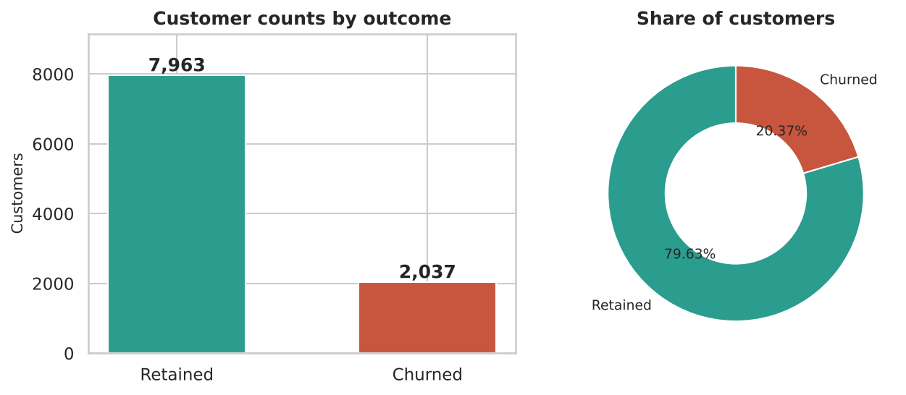

*Figure 1. Distribution of churned and retained customers*

The portfolio is imbalanced: 79.63% retained and 20.37% churned.

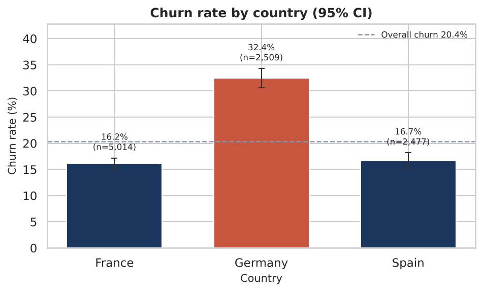

*Figure 2. Churn rate by country with 95% confidence intervals*

Germany stands apart. The confidence intervals for France (15.2-17.2%) and Spain (15.3-18.2%) overlap with each other and sit far below Germany (30.6-34.3%).

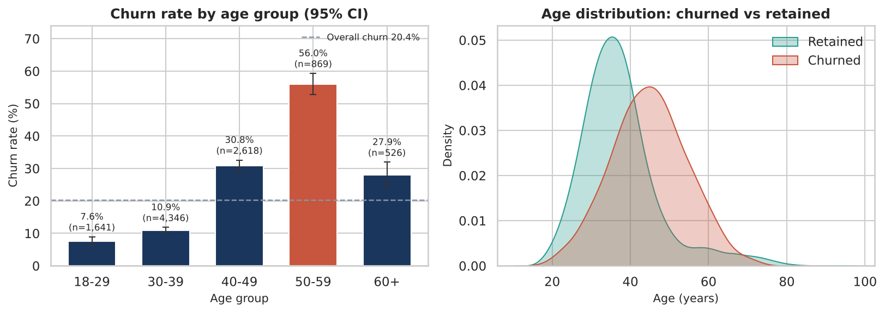

*Figure 3. Churn rate by age group and age distributions of churned and retained customers*

Churned customers are concentrated in the middle and older age range, while retained customers cluster in the mid-30s. Churn peaks in the 50-59 group.

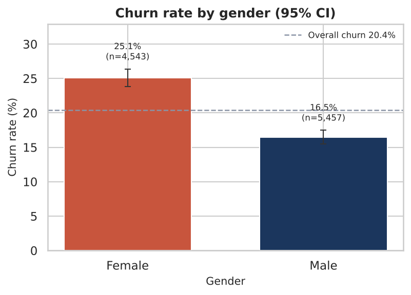

*Figure 4. Churn rate by gender*

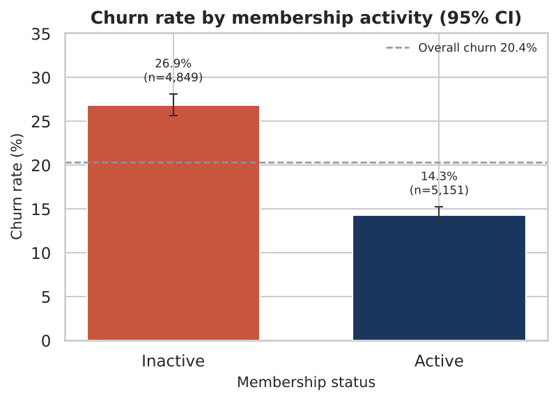

*Figure 5. Churn rate by active versus inactive membership*

Female customers and inactive members churn more often than male customers and active members. Activity is the only engagement variable in the data that shows a clear association with churn.

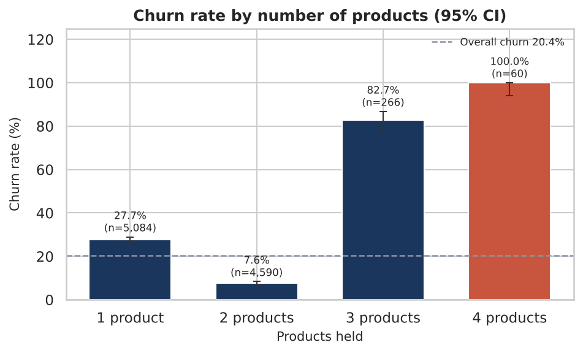

*Figure 6. Churn rate by number of products held*

Two products is the lowest-churn group; one product is above average; three and four products are extreme outliers in a small number of customers.

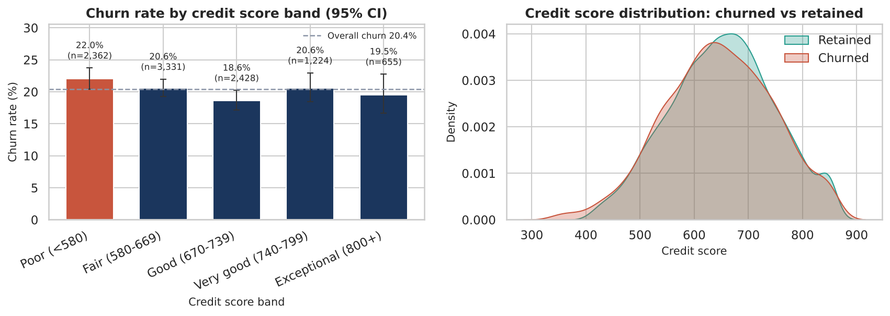

*Figure 7. Credit score bands and credit score distributions by churn outcome*

The distributions of credit scores for churned and retained customers almost overlap, matching the statistical result that credit score is not a useful discriminator.

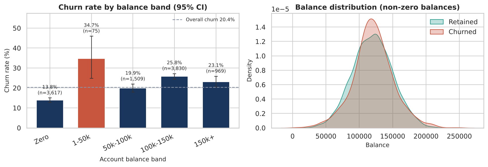

*Figure 8. Balance bands and balance distributions (non-zero balances) by churn outcome*

Churn is lowest for zero balances and higher for balances above 100k. The median balance of churned customers is 109,349 versus 92,073 for retained customers.

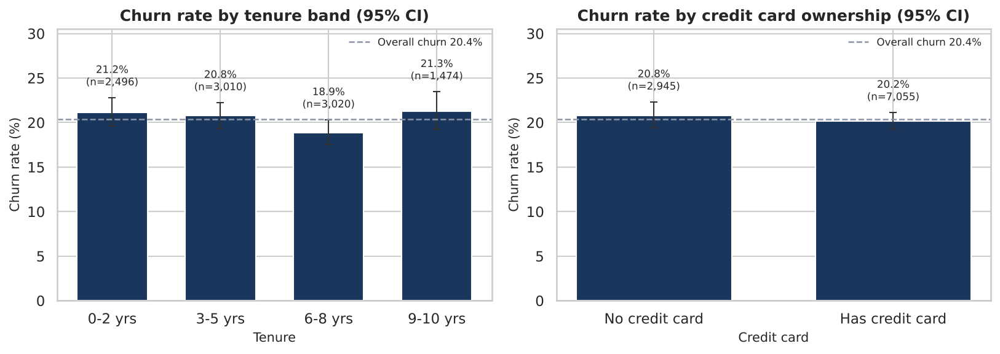

*Figure 9. Churn rate by tenure band and credit card ownership*

Neither tenure nor credit card ownership separates churned from retained customers.

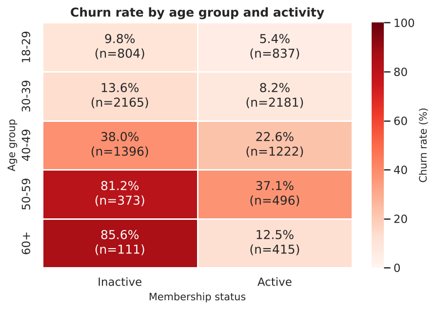

*Figure 10. Churn rate by age group and activity status*

Churn is highest where age and inactivity combine: 85.6% for inactive customers aged 60+ and 81.2% for inactive customers aged 50-59. Active customers aged 60+ churn at 12.5%, below the portfolio average.

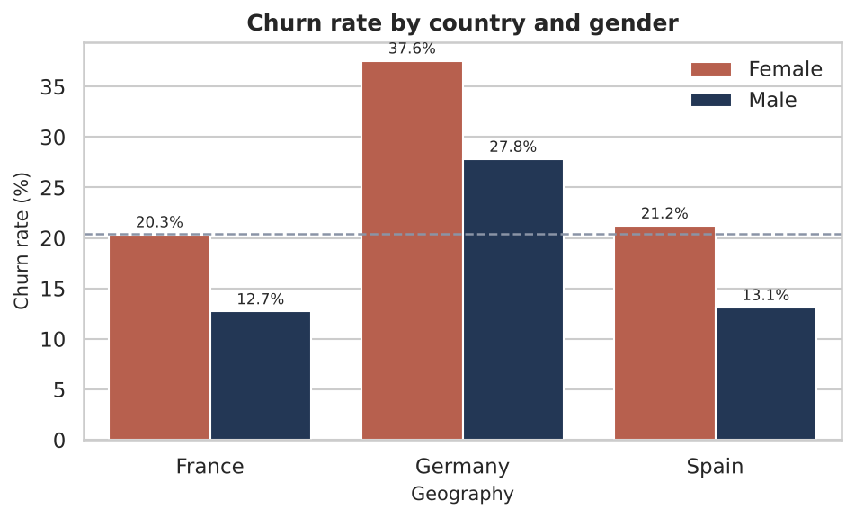

*Figure 11. Churn rate by country and gender*

Within every country females churn more than males; the highest rate is for German females (37.6%) and the lowest for French males (12.7%).

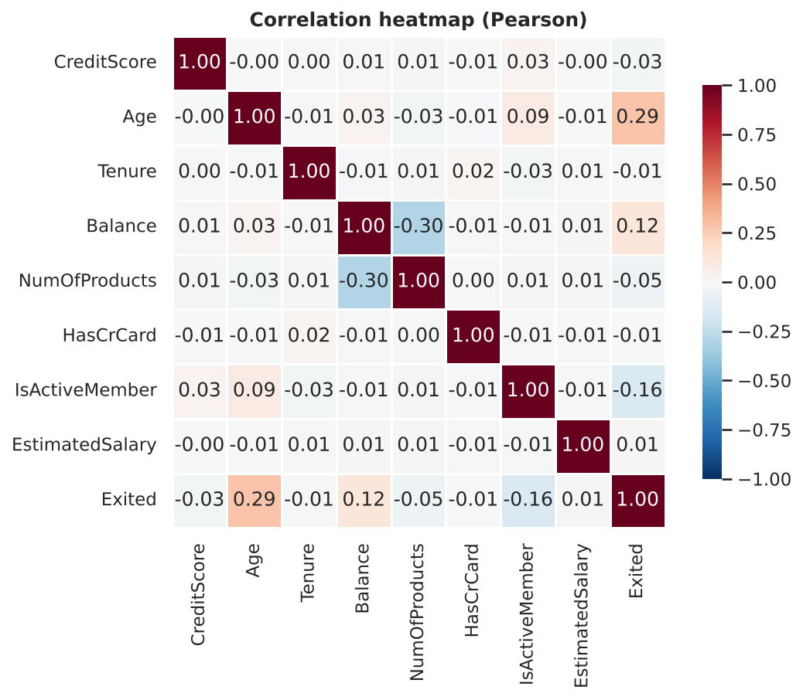

*Figure 12. Correlation heatmap of numeric variables and churn*

Correlations among the explanatory variables themselves are modest: the strongest is between Balance and NumOfProducts (-0.30). No two of the main drivers (age, activity, products, country) are close to duplicates of each other, so each carries its own information.

## 7. Customer Segmentation

Six mutually exclusive segments were defined with simple rules (Table below). The rules are applied in the order listed, so a customer with three or more products is always placed in Product Overload regardless of age or country.

**Table 7. Segment definitions and churn results**

| Segment | Rule | Customers | Churned | Churn rate | 95% CI |
|---|---|---|---|---|---|
| Product Overload | Holds 3 or 4 products (checked first) | 326 | 280 | 85.9% | 81.7 - 89.3% |
| Inactive 50+ | Age 50 or over and not an active member | 434 | 348 | 80.2% | 76.2 - 83.7% |
| Active 50+ | Age 50 or over and an active member | 869 | 199 | 22.9% | 20.2 - 25.8% |
| Mid-Life Germany | Age 40-49, Germany, 1-2 products | 690 | 287 | 41.6% | 38.0 - 45.3% |
| Mid-Life France & Spain | Age 40-49, France or Spain, 1-2 products | 1,805 | 406 | 22.5% | 20.6 - 24.5% |
| Under 40 | Age under 40, 1-2 products | 5,876 | 517 | 8.8% | 8.1 - 9.5% |

**Table 8. Segment profile and balance exposure**

| Segment | Share of customers | Share of churners | Avg. age | Avg. balance | Share of churned balance |
|---|---|---|---|---|---|
| Product Overload | 3.3% | 13.7% | 43.7 | 78,822 | 13.2% |
| Inactive 50+ | 4.3% | 17.1% | 56.0 | 88,646 | 17.1% |
| Active 50+ | 8.7% | 9.8% | 60.2 | 76,927 | 10.0% |
| Mid-Life Germany | 6.9% | 14.1% | 43.8 | 119,665 | 18.5% |
| Mid-Life France & Spain | 18.1% | 19.9% | 43.5 | 62,303 | 15.3% |
| Under 40 | 58.8% | 25.4% | 32.3 | 74,679 | 26.0% |

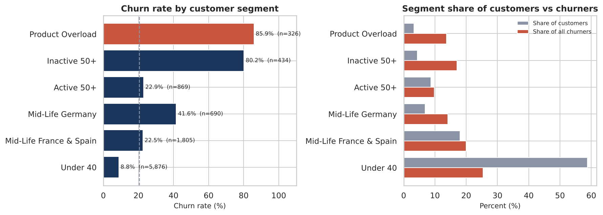

*Figure 13. Churn rate by segment and each segment's share of customers versus churners*

### 7.1 Segment descriptions

**Product Overload (3-4 products).** 326 customers, churn 85.9%, the highest of any segment. Only 3.3% of customers but 13.7% of churners, and 13.2% of the balance held by churned customers. The data cannot say why these customers leave; fees, service quality or product mis-selling are hypotheses to investigate. Business value: small group, high loss rate, moderate average balance (78,822).

**Inactive 50+.** 434 customers, churn 80.2%. Average balance 88,646, which is above the portfolio average of 76,486. They account for 17.1% of churned balances while being 4.3% of customers. Business value: a compact, high-risk group holding meaningful balances, and one that can be identified from a simple activity flag.

**Active 50+.** 869 customers, churn 22.9%, near the portfolio average of 20.4% even though the age band is high-risk overall. Being an active member appears to offset much of the age-related risk. Business value: an engaged older base worth protecting.

**Mid-Life Germany (40-49, 1-2 products).** 690 customers, churn 41.6%. This segment has the highest average balance of all segments (119,665) and holds 18.5% of churned balances, the largest share among the high-risk segments. Business value: high balance exposure combined with high churn.

**Mid-Life France & Spain (40-49, 1-2 products).** 1,805 customers, churn 22.5%, close to average. Business value: a large mid-age base with moderate risk; compared with Mid-Life Germany it shows how much of the risk is country-specific.

**Under 40 (1-2 products).** 5,876 customers, churn 8.8%, the lowest of any segment. This segment is 58.8% of customers and, because it is so large, still accounts for 26.0% of churned balances. Business value: low risk per customer, but volume matters; monitoring rather than intervention is indicated.

## 8. Baseline Predictive Model

A proper train-test evaluation was run (Section 4.4). On the held-out test set, which has a churn rate of 20.3%, gradient boosting reaches a ROC-AUC of 0.870 (five-fold cross-validation on the training data: 0.864 +/- 0.011) while logistic regression reaches 0.775. Logistic regression is weaker because the effect of products and age is non-linear.

**Table 9. Model performance on the held-out test set**

| Model | ROC-AUC | PR-AUC | Accuracy | Precision | Recall | Top 10% churn rate | Churners in top 20% |
|---|---|---|---|---|---|---|---|
| Logistic regression | 0.775 | 0.479 | 80.8% | 58.9% | 18.7% | 54.0% | 48.4% |
| Gradient boosting | 0.870 | 0.719 | 87.0% | 80.0% | 48.2% | 83.5% | 63.1% |

Precision, recall and accuracy use a 0.5 probability threshold. Always predicting 'retained' would score 79.7% accuracy, so accuracy alone is a weak yardstick here. For gradient boosting, the 10% of test customers with the highest predicted risk had an actual churn rate of 83.5%, and the top 20% captured 63.1% of all churners. At the 0.5 threshold the model finds 48.2% of churners with 80.0% precision; a lower threshold would trade precision for recall.

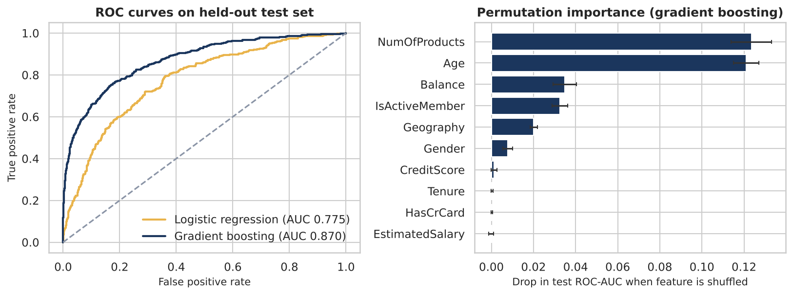

*Figure 14. ROC curves and permutation feature importance on the test set*

Permutation importance ranks NumOfProducts and Age far above all other variables, followed by Balance and IsActiveMember; shuffling credit card ownership, tenure or estimated salary changes the score by almost nothing. This agrees with the descriptive and statistical findings.

> Interpretation limits: the model is a baseline, not a deployable system. It was validated on a random split of one snapshot, not on a later period. Attributes such as balance and activity are recorded at the same time as the outcome and may partly reflect a customer who is already leaving. It should be read as evidence that the listed attributes carry real signal, not as a guarantee of future accuracy.

## 9. Key Findings

1. Overall churn is 20.37% (2,037 of 10,000 customers).
2. Number of products and age are the strongest drivers. Customers with 3-4 products churn at 85.9%; the 50-59 age group churns at 56.0%.
3. Germany churns at 32.4%, about double France and Spain, and contributes 40.0% of churners from 25.1% of customers.
4. Inactive members churn at 26.9% versus 14.3% for active members; inactivity combined with age 50+ gives 80.2% churn.
5. Female customers churn at 25.1% versus 16.5% for males.
6. Credit score, tenure, credit card ownership and estimated salary show no meaningful association with churn.
7. Product Overload and Inactive 50+ together are 7.6% of customers, 30.8% of churners and 30.3% of the balances held by churned customers.
8. Churned customers held 185.6 million balance units, 24.3% of all balances in the dataset (764.9 million).
9. A baseline gradient boosting model ranks churn risk well on held-out data (ROC-AUC 0.870).

## 10. Business Recommendations

> The recommendations below are proposals derived from the evidence. They are not findings of the data. Each one should be tested on a small scale, with a comparison group, before wide rollout.

1. **Prioritise the two highest-risk segments in a pilot retention programme.** Product Overload and Inactive 50+ are 7.6% of customers but 30.8% of churners, so a small, targeted effort covers a large share of attrition. Use a randomly assigned control group to measure whether outreach actually reduces churn.
2. **Investigate the 3-4 product experience.** Review fees, bundling, onboarding and support for customers who hold three or more products, and interview or survey a sample of those who left. The data shows the outcome, not the cause.
3. **Run a country-specific review for Germany**, where mid-life customers churn at 41.6%: pricing, competitor offers, service channels and product fit.
4. **Re-engage inactive customers early**, particularly those aged 40 and over, and test whether raising activity lowers churn. Activity is associated with lower churn, but it may also be a symptom rather than a cause.
5. **Pilot a risk-ranking model as a decision aid.** Validate it on a later period before use, monitor accuracy over time, and keep staff judgement in the loop.
6. **Review fairness and legal compliance** before using age or gender in any targeting rule, in line with applicable EU and national non-discrimination and data-protection requirements. Behavioural and product variables are safer and more actionable targeting criteria.
7. **Improve the data.** Add churn dates, multi-year history, transaction and complaint records, channel and revenue data so that cause, timing and profitability can be analysed.

## 11. Limitations

- **Single snapshot.** The data covers one year and gives no churn date, so timing, trends and seasonality cannot be studied.
- **Association, not causation.** The analysis is observational; no finding shows that changing a variable would change churn.
- **Possible reverse causality.** Variables such as balance and activity are measured together with the outcome and may reflect customers who are already leaving.
- **In-sample segments.** Segment rules were derived from this dataset, so segment churn rates are descriptive and likely optimistic as forecasts for new data.
- **Small groups.** Customers with four products (60), the 1-50k balance band (75) and some age-activity cells are small; their rates carry wide confidence intervals.
- **Baseline model.** No hyperparameter tuning, no out-of-time validation and no calibration study were done.
- **Missing business data.** The file contains no revenue, margin, cost or customer-contact data, so profit impact cannot be estimated. Currency and the unit of tenure are not stated in the file.
- **Provenance.** How the data was collected and whether it represents the bank's full customer base is not documented in the file; the findings describe the dataset supplied.

## 12. Conclusion

About one in five customers in this dataset churned. The risk is concentrated rather than evenly spread: it is highest among customers who hold three or more products, who are 50 or over and inactive, and who are in mid-life in Germany, while customers under 40 and those with two products are the most stable. Credit score, tenure, credit card ownership and salary add little. A small number of explainable segments captures a large share of attrition, and a baseline model confirms that the same attributes carry predictive signal. The next step is not to scale interventions blindly but to test them in controlled pilots, investigate the causes behind the highest-risk groups, and enrich the data.

## Appendix: Reproducibility

All figures in this paper were generated by scripts/analysis_core.py and scripts/build_project.py from European_Bank.csv. Running python scripts/build_project.py from the project folder regenerates the charts, analysis_report.csv, statistical_tests.csv, research_paper.md and both PDFs. The random seed is fixed at 42.
